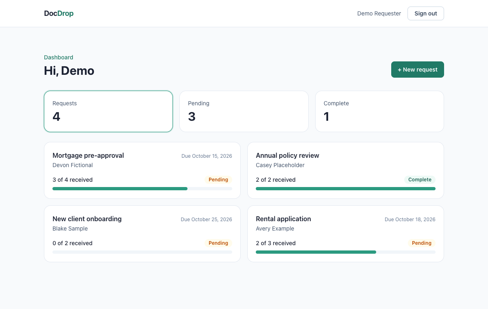
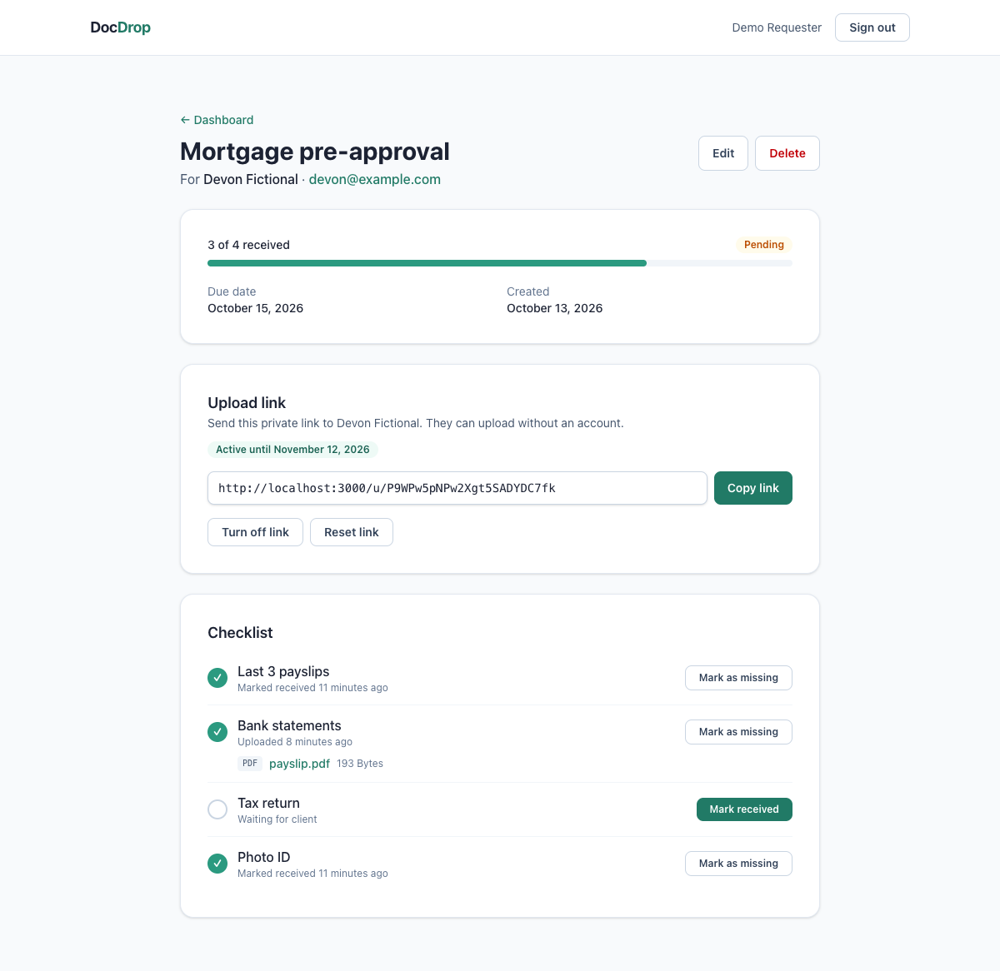
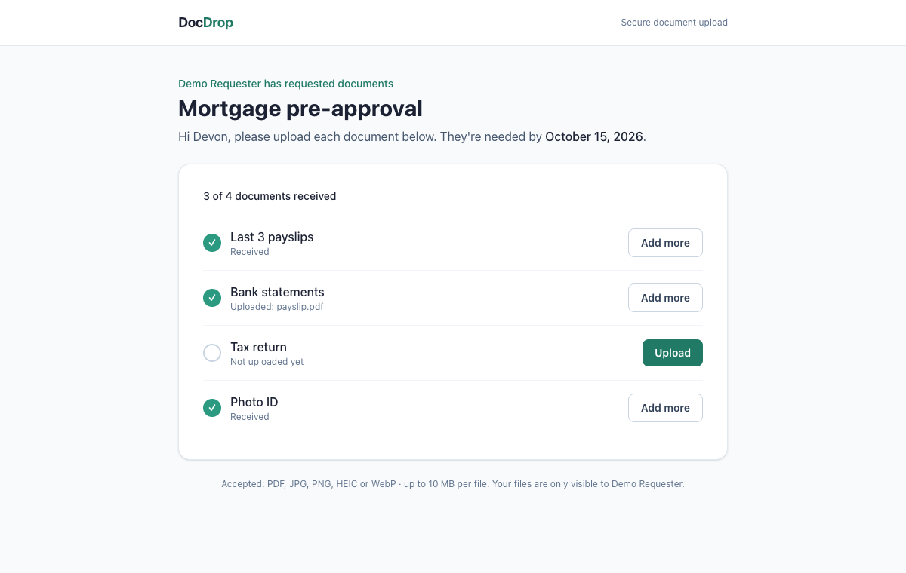
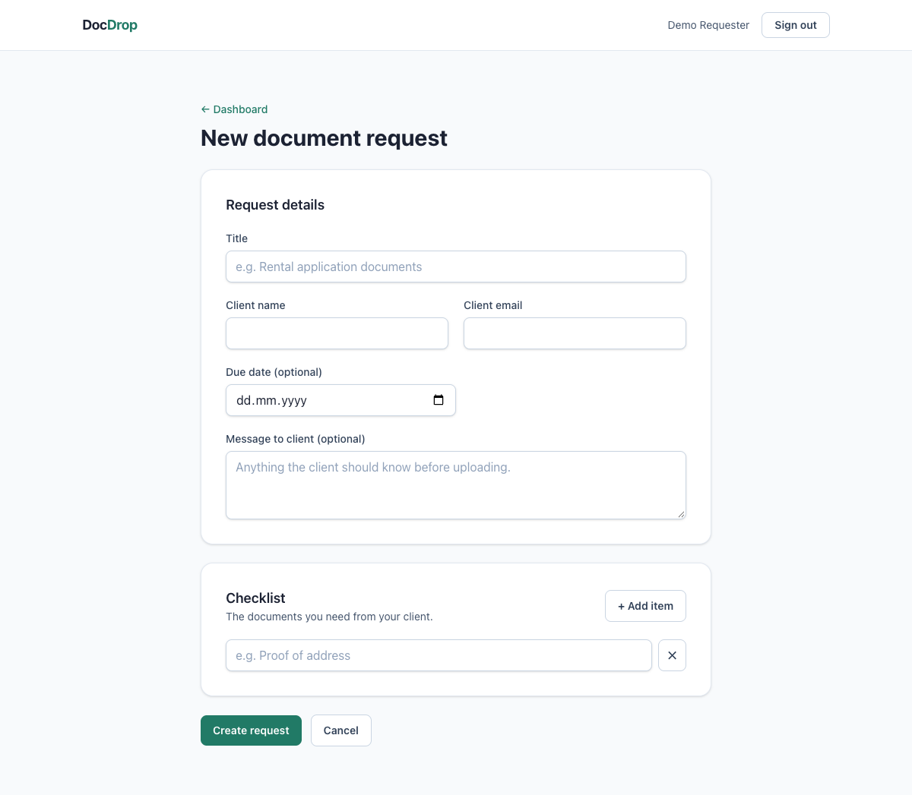
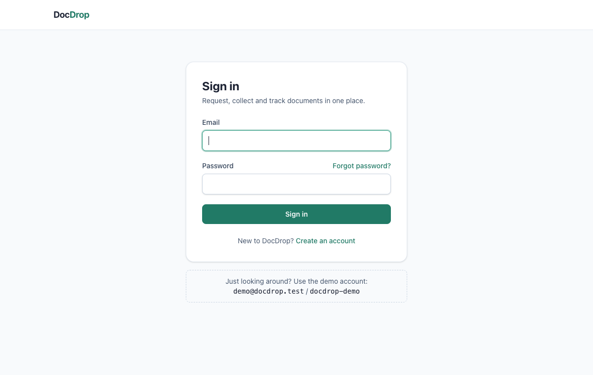
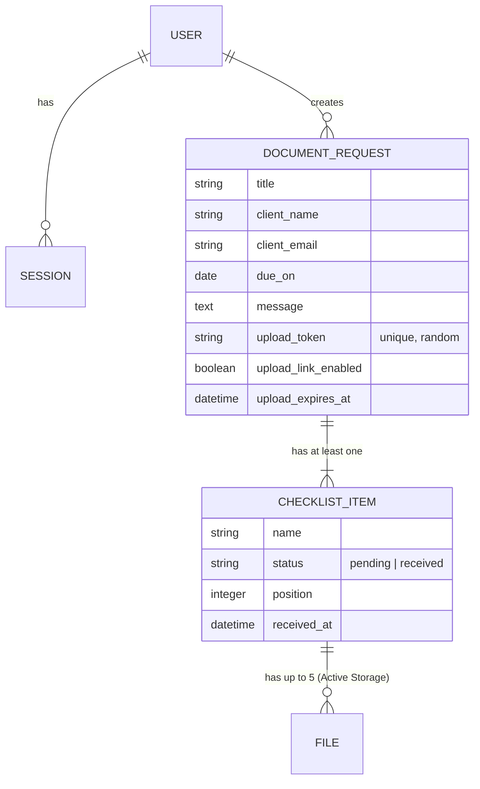

# DocDrop

**Request documents from clients, collect them through a private upload link, and see at a glance what's still missing.**

DocDrop is a small full-stack Rails app I built as an independent portfolio project. It's inspired by the document-collection workflows I worked on in insurance technology, but it's my own original product with synthetic demo data only.



**Stack:** Ruby on Rails 8.1 · Hotwire (Turbo + Stimulus) · PostgreSQL · Active Storage · Tailwind CSS · Minitest + Capybara · GitHub Actions

---

## What it does

1. **A requester signs up** and creates a document request for a client, with a checklist of what they need (for example "Photo ID", "Proof of address").
2. **DocDrop generates a private upload link.** The requester copies it and sends it to the client.
3. **The client opens the link, no account needed,** and uploads a file for each item. Each item is ticked off as it arrives.
4. **The requester tracks progress** on the dashboard (pending, complete, overdue) and downloads the files.

| Requester: request page | Client: upload page |
| --- | --- |
|  |  |

<details>
<summary>More screenshots</summary>

**Creating a request.** Checklist rows are added and removed in place with Stimulus.



**Sign in**, with the demo account shown for visitors.



</details>

### Try it locally with the demo account

After [setup](#running-it-locally), sign in with **`demo@docdrop.test`** / **`docdrop-demo`**. Open any request, copy its upload link, and paste it into a private browser window to see the client's side.

---

## Technical decisions

### Clients upload without an account
Asking a client to create an account just to send a few documents adds friction. Instead, each request has an **unguessable link** (`has_secure_token`, about 140 bits of randomness), so the page can only be reached by someone who has the link. That is also why the requester can turn it off or reset it at any time.

The requester controls the link from the request page:
- **Turn off / turn on.** Turning it back on renews the link for another 30 days.
- **Reset.** A new token is issued and the old link stops working immediately.
- Links **expire after 30 days**.

### Uploads are checked before anything is stored
`ChecklistItem#submit_files` validates the whole batch first and attaches files only if every one passes, so a bad file never lands in storage:
- **Type is detected from the file's contents** (magic bytes, via Marcel), not its name or the browser's claim. A text file renamed to `.pdf` is rejected. Allowed: PDF, JPG, PNG, HEIC, WebP.
- **At most 10 MB per file and 5 files per checklist item.**
- Uploading marks the item received and records when.

### Files are private by default
Active Storage normally serves files through permanent public URLs: anyone with the link can download. DocDrop **turns those routes off** (`config.active_storage.draw_routes = false`). Files are served only by `FilesController`, which looks the file up through the signed-in requester's own requests.

### Requesters only ever see their own data
Every lookup is scoped through `Current.user.document_requests`, so another requester's request, checklist item, upload link or file returns **404**, never a 403 that confirms it exists. Controller tests cover each of these paths.

### The upload page leaks as little as possible
- Unknown, disabled and expired links all render **the same "link unavailable" page** with a 404, so the page can't be used to find out which tokens exist.
- A `noindex` meta tag keeps it out of search engines, and a `no-referrer` policy keeps the token out of `Referer` headers if the client clicks a link.
- Uploads and sign-in attempts are **rate limited** with Rails 8's built-in `rate_limit`.

### Hotwire instead of a JavaScript framework
The interactive parts are small, so server-rendered HTML with Turbo and Stimulus keeps the app simple:
- **Turbo Streams** update a checklist row and the progress bar in place when an item is marked received or a file is uploaded.
- **Stimulus controllers** (`app/javascript/controllers`): add and remove checklist rows in the form, turn file picking into one-click upload, and copy the upload link. Each one is a few dozen lines.
- The core flows still work **without JavaScript** (uploading, marking items received, managing the link): forms fall back to normal submits and redirects. Adding extra checklist rows is the one part that needs JavaScript.

### Rails 8 defaults where they fit
Authentication uses the Rails 8 generator (sessions, password reset, `has_secure_password`) rather than a gem, with sign-up and validations added on top. That keeps the auth code small and readable in the repo.

---

## Data model



A request is **pending** while any item is pending and **complete** once all are received. The dashboard filters use SQL scopes (`DocumentRequest.pending` and `.complete`), so the counts come straight from the database.

---

## Testing

```bash
bin/rails test          # 82 model and controller tests
bin/rails test:system   # 6 browser tests in headless Chrome
bin/ci                  # style, security audits, tests and seeds, like CI
```

- **Model tests:** validations, progress and status, upload-link states, and file checks, including a disguised file, an oversized file, too many files, and a mixed batch where nothing should be stored.
- **Controller tests:** every route, including the 404 paths for other requesters' data and for disabled or expired links.
- **System tests:** the full journeys in a real browser. A requester signs up, builds a checklist and marks items received. A client uploads through the link, the requester sees and downloads the file, and a turned-off link blocks the client.

GitHub Actions runs RuboCop, Brakeman, an importmap audit and both test suites on every push.

---

## Running it locally

Requirements: **Ruby 3.4.11**, **PostgreSQL 14+**, and Google Chrome for the system tests.

```bash
git clone https://github.com/renataosborne/docdrop.git
cd docdrop
bin/setup        # installs gems, creates and seeds the database, starts the server
```

Then open http://localhost:3000 and sign in with the demo account above. `bin/dev` starts the server and the Tailwind watcher on later runs, and `bin/rails db:seed` resets the demo data.

---

## Roadmap

**Version 1 (done):** sign-in, requests with checklists, private upload links, file checks, dashboard, tests and CI.

**Next:**
- [ ] Deployed demo with persistent file storage
- [ ] Email notifications: send the link to the client, notify the requester on upload (Action Mailer + background jobs)
- [ ] Live updates on the requester's page when a client uploads (Turbo Stream broadcasts)
- [ ] Requester can reject a file with a note, so the client re-uploads
- [ ] Virus scanning of uploads in a background job

---

## About

Built by **Renata Osborne**, a full-stack engineer working mainly in Ruby on Rails, Hotwire and TypeScript.
[Portfolio](https://renataosborne.github.io) · [LinkedIn](https://www.linkedin.com/in/renata-osborne-5a3569190)

All names, emails and documents in the demo data are fictional.
